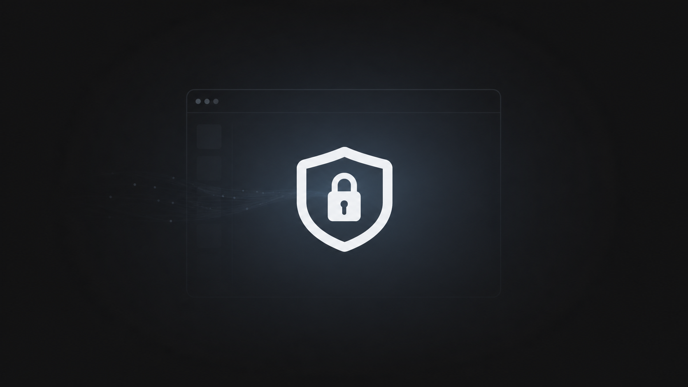
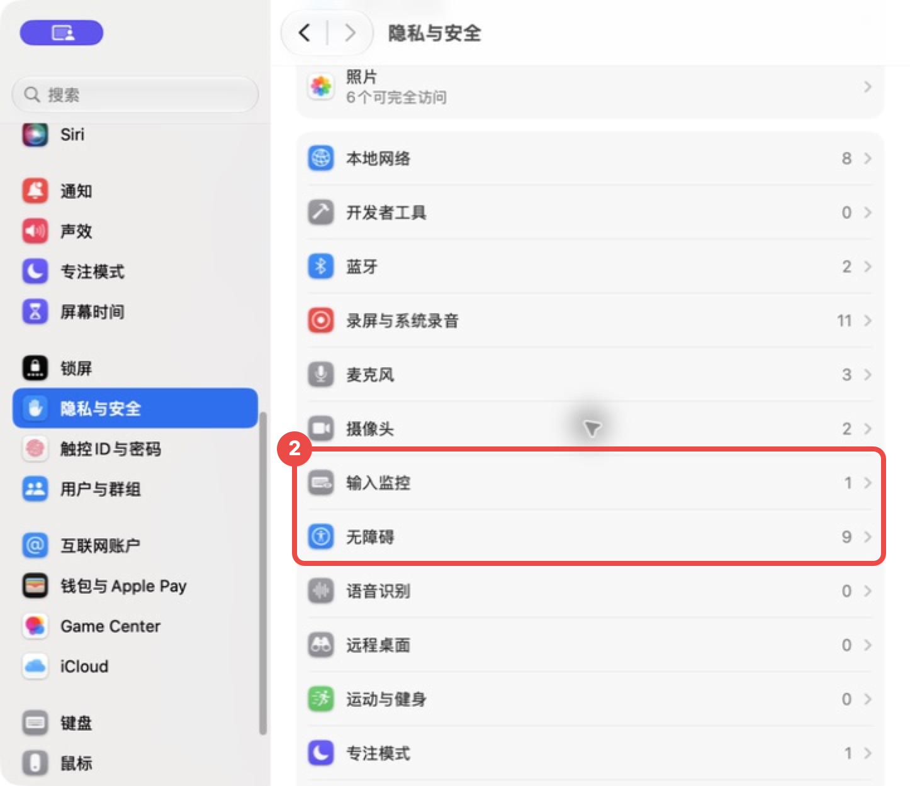
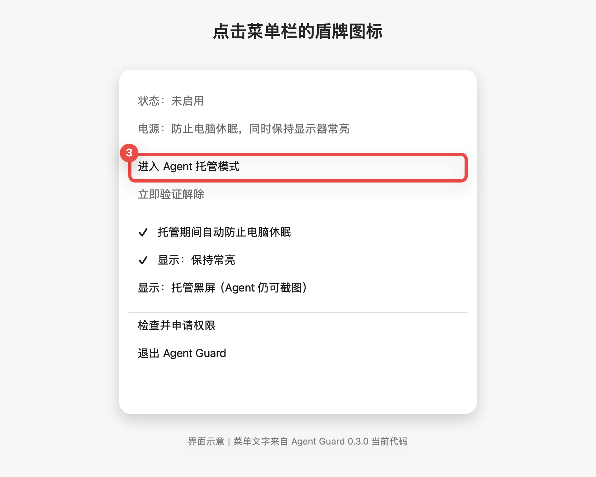

# Agent Guard：让 AI 继续工作，但不让旁人操作电脑



## 先说结论

在日常使用 AI Agent 工作时，我们可能会遇到这些情况：

- AI 正在执行需要持续点击、输入或截图的长任务，但我们无法一直守在电脑前。
- 我们需要暂时离开工位，又不希望别人误碰电脑。
- 我们希望隐藏现场画面，但又不能让 AI 失去当前桌面。
- 我们已经下班了，但希望 AI 继续完成任务或保持待命。

但这些场景都会遇到同一个问题：普通锁屏或真正熄屏，可能让 Agent 失去阅读与操作屏幕的能力（GUI）；可如果让电脑一直保持可操作，又容易被现场的人误碰，也可能暴露屏幕内容。

Agent Guard 是一个 macOS 菜单栏小工具。进入托管后：

- 现场的实体键盘、鼠标和触控板会被拦截。
- AI Agent 的软件点击、输入和截图继续工作。
- 电脑保持唤醒，不会因为空闲休眠而中断任务。
- 可以选择保持屏幕常亮，或让现场看到黑屏、Agent 继续看到桌面。
- 用户按实体空格键，再通过 Touch ID 或系统密码解除托管。

可以把它理解成：**把当前桌面临时交给 AI 使用，同时把最终控制权留在用户手里。**

## 安装与使用

### 1. 安装 App

当前源码版本为 **0.3.10（构建 21）**。本机已安装并完成熄屏 Agent 操作、空格唤醒认证及主进程异常恢复验证。[GitHub Releases](https://github.com/zoujoe30/Agent-Guard/releases) 的正式安装包需完成 Developer ID 签名与 Apple 公证。

以下为取得经确认的安装包后的操作说明，截图用于说明安装与使用流程。

双击安装包，依次点击“继续”和“安装”，再通过 Touch ID 或管理员密码确认。安装完成后，`Agent Guard.app` 会出现在 Mac 的“应用程序”文件夹中。


如取得 ZIP 备用包，可以解压后把 `Agent Guard.app` 拖进“应用程序”文件夹。

要求 macOS 14 或更高版本。已验证的本地构建面向 Apple 芯片 Mac；正式发布流程计划生成 Apple 芯片与 Intel 通用包，Intel 实机兼容性尚未验证。

### 2. 打开两个权限

如果 Mac 阻止打开安装包或第一次打开 App：

1. 按住 Control 键，再点击安装包或 `Agent Guard.app`。
2. 选择“打开”。
3. 如果仍然打不开，前往“系统设置 → 隐私与安全性”，点击“仍要打开”。

打开 App 后，进入：

**系统设置 → 隐私与安全性**

找到“输入监控”和“辅助功能”：



分别点进去，把 `Agent Guard` 后面的开关打开：


两个开关都打开后，退出并重新打开一次 Agent Guard。

### 3. 进入托管

按实体键盘的 `右 Command + G` 即可直接进入托管。菜单右侧会显示 `右⌘ G`；左 `Command + G` 保持系统和软件原有功能。也可点击 Mac 右上角菜单栏里的盾牌图标，再点击“进入 Agent 托管模式”。



0.3.9 在进入前检查系统安全输入和监听状态；安全输入开启或监听恢复失败时，会拒绝进入并提示原因。

正常进入后，现场的键盘、鼠标和触控板会被锁住，但 AI Agent 仍能继续操作电脑，电脑也不会自动休眠。

这一步必须由你使用实体键盘触发，或亲自点击菜单；AI Agent 的合成键盘事件不会触发快捷开启。

如果要切换“保持常亮”和“托管黑屏”，点击对应选项后菜单会继续保持打开，方便继续操作；点击菜单外部即可关闭。

### 4. 解除托管

回到电脑前，按一下实体空格键，然后用 Touch ID 或 Mac 密码验证。

验证成功后，键盘、鼠标和触控板会恢复正常。如果没有完成验证，认证窗口会在约 10 秒后消失；监听与显示恢复检查通过后继续托管，否则显示“托管恢复异常”，不会把恢复失败当成验证成功。

## 常见问题

### 为什么不直接用 macOS 锁屏？

系统锁屏的安全性更高，但 GUI Agent 通常无法继续看到和操作用户桌面。Agent Guard 解决的是“保持当前 GUI 会话可用，同时阻止现场实体操作”这个不同的问题。

### 为什么不用普通熄屏？

普通显示器睡眠可能让 Agent 的截图链路失效。托管黑屏只隐藏物理输出，不让系统桌面一起睡眠。

### 按空格没有反应怎么办？

空格无响应可能与输入监听异常、macOS 安全输入或系统锁屏有关。0.3.9 在进入前检查安全输入，并在托管期间约每 0.5 秒检查安全输入和监听健康；主线程繁忙时检测可能延迟。发现异常后应用会尝试恢复显示，并显示“托管恢复异常”。此时可用实体鼠标打开菜单，选择“立即验证解除”，再通过 Touch ID／系统密码验证；该路径不再要求先恢复键盘监听。异常状态会放行实体输入以便操作菜单，不应视为正常的输入保护状态；若系统监听本身失效，无法保证输入拦截。

本版不修改其他应用的安全输入设置，尚未实现系统锁屏／解锁联动，不能保证消除所有键盘失效。若所有正常恢复方式均无效，持续按住电源／Touch ID 键强制关机后重启仅作为最后手段；这会中断 Agent 任务，并可能丢失未保存内容。

### 黑屏后怎么恢复？

0.3.10 通过软断开外屏使其进入无信号待机；Agent 在保持在线的内屏桌面继续操作。外屏窗口可能临时迁移，重连后的恢复依赖 macOS 和应用。

按实体空格并完成 Touch ID／密码验证。不要强制关机。认证开始前，Agent Guard 会先恢复内外显示输出。

### 可以让 Agent 自动解锁吗？

不可以。Agent 只能查询状态和切换显示方式，不能进入、退出或解除托管。

### 如何卸载？

先从菜单栏退出 Agent Guard，再把 `/Applications/Agent Guard.app` 移到废纸篓。需要时可以在“隐私与安全性”中移除它的辅助功能和输入监控权限。

---

## 运作原理（选读）

Agent Guard 的核心不是“把输入全部关掉”，而是在同一个 macOS 登录会话里尽量分开处理用户和 Agent。

### 1. 输入来源分类

macOS 的键盘和鼠标事件带有来源信息。

Agent Guard 会拦截没有用户态来源进程的实体 HID 事件，同时放行有明确用户态来源进程的软件合成事件。

因此，现场的鼠标和键盘不能操作，但 GUI Agent 仍可以点击和输入。

不同 Agent 生成输入事件的方式可能不同。如果某个 Agent 的事件在 macOS 看来和实体 HID 事件一样，它也可能被拦截。

### 2. 临时防休眠

进入托管后，Agent Guard 会向 macOS 申请临时电源断言，阻止电脑和显示器因为空闲进入睡眠。

退出托管或退出 App 后，断言会被释放。它不会永久修改电脑原本的节能设置。

### 3. 物理黑屏与系统桌面分离

真正让显示器睡眠后，部分 GUI Agent 会拿不到可用桌面。

Agent Guard 的托管黑屏把两件事分开：

```text
物理显示输出：黑
系统桌面与截图：继续运行
```

现场看不到页面，但 WindowServer、窗口坐标和截图仍然存在，Agent 因此可以继续操作。

这只能减少普通现场窥屏，不等于系统锁屏，也不能防止拥有系统权限的软件读取桌面。

### 4. 最小化 Agent 权限

Agent 只获得：

- 查询托管状态。
- 切换为保持常亮。
- 切换为托管黑屏。

进入托管必须由用户按实体 `右 Command + G` 或亲自点击菜单；正常解除由实体空格键触发；恢复异常时也可通过菜单发起验证。两条路径都必须通过 macOS 系统认证。

Agent Guard 不自行保存密码，也不读取 Touch ID 数据。

### 5. 当前验证范围

0.3.10 的120项自动检查通过。本机已实测熄屏期间Agent截图、点击和输入，实体空格恢复显示并完成认证，以及主进程异常退出后的自动显示恢复。外屏恢复2560×1440、120Hz。自动检查和单机实测均不代表所有场景；热插拔、长期运行、Spaces/全屏及不同硬件仍待验收，详见 [验证记录](VALIDATION-0.3.10.md)。

---

## 关于「AI 在个人工作中的应用」

Agent Guard 是「AI 在个人工作中的应用」系列的第一个小项目。

这个系列不只介绍 AI 模型或提示词，而是持续分享我在真实工作里怎么发现问题、用 AI 和代码做出工具、实际验证，再把能复用的部分整理给大家。

后续我会继续在公司社区发布：

- 可直接使用的 AI 小工具；
- AI Agent 在真实工作中的用法；
- 从需求到实现的过程和踩坑；
- 安装包、教程和进阶原理；
- 哪些场景适合 AI，哪些边界必须由人负责。

如果这篇文档来自一条公司社区帖子，可以回到帖子下交流使用结果和问题；也可以在公司社区持续关注「AI 在个人工作中的应用」系列。后续新版本、兼容性结论和新的 AI 实践会优先在社区更新。
